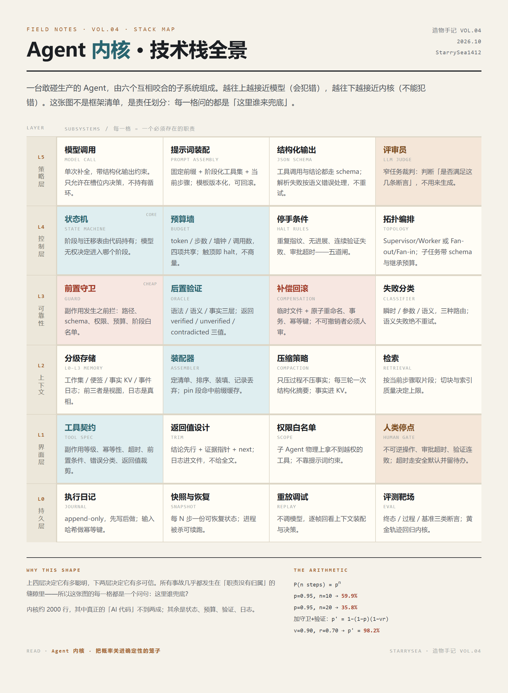

# Agent 内核 · 把概率关进确定性的笼子

造物手记 VOL.04。一篇不聊提示词技巧、只拆运行时的深度长文：**为什么一个 10 步任务即使每步 95% 正确，端到端也只有 59.9%；以及一个不到两千行的内核怎样把这条曲线扳回来。**

**[打开这一页 →](https://starrysea1412.github.io/agent-kernel/)**

## 六章

| # | 章节 | 讲什么 |
|---|---|---|
| 01 | 控制流的幻觉 | ReAct 循环的三种致命缺陷；控制反转；确定性的三个档位；状态机骨架；五道停手闸 |
| 02 | 0.95 的十次方 | 可靠性断崖的算术；守卫 / 验证 / 回滚三道防线；重试的三层分类；三值验证 |
| 03 | 上下文的熵 | 中间遗忘、注意力汇、干扰效应；四级存储；预算施工图；压缩的三种做法与坑；装配器代码 |
| 04 | 工具即界面 | 正交优于齐全；返回值是给模型的 UI；错误信息是产品文案；可反悔性分级；工具契约 |
| 05 | 多智能体的迷思 | 群聊的三个数学问题；两种有效拓扑；类型化委托；预算继承与级联取消 |
| 06 | 崩溃之后 | 每步即事务；先写日志再执行；重放调试；给概率系统写测试；内核的能与不能 |

## 三枚可玩小样

- **可靠性断崖**：拖动步数（1–30）与单步成功率（80–99%），看裸奔链与「守卫+验证+修复」两条曲线分岔，并逐格推演这次死在第几步、错误如何向后污染。
- **上下文衰减**：拖到第 15 轮，看上下文如何从工作台变成垃圾场；一键切换阶梯压缩，观察信噪比、注意力质量与目标召回率的变化。
- **拓扑沙盘**：同一任务，群聊式 vs 分层式，逐轮跑完六轮，对比消息数、token 与「有效结论 / 重复噪声」的比例。

三枚小样都是**确定性模型**（可核对的公式写在正文里），不是录屏；参数与假设都摊在明面上。

## 技术实现

- `index.html` 单文件承载：零构建、零依赖、原生 JS，全部示意图是手写 SVG（可无损缩放）。
- 正文字体：霞鹜文楷（SIL OFL 1.1），按本文用字子集化（约 1100 字）后自托管于 `assets/fonts/`，单个 woff2 约 233 KB。
- 五张插图：GPT 系图像模型生成，转 WebP（原 PNG 单张 2–3 MB → WebP 约 160–400 KB）。
- 技术栈全景图：`docs/tech-stack.html` 渲染为 `assets/tech-stack.png`（Chrome headless，2× DPR）。

## 参考

ReAct (Yao et al., 2022) · Lost in the Middle (Liu et al., 2023) · Attention Sinks (Xiao et al., 2023) · Anthropic《Building effective agents》(2024)，以及作者在 hermes-agent-workbench、cc-probe、video-agent-lab、dynamic-workflows 四套系统上的实测记录。

---

造物手记 VOL.04 · 2026.10 · StarrySea1412
